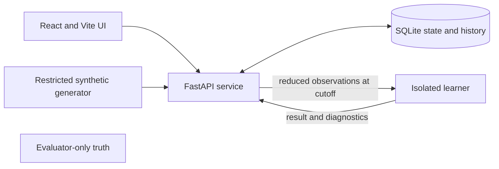

# REMission

REMission is a synthetic research prototype for exploring longitudinal insomnia-care decisions and clinical analytics. It connects a fictional patient workflow to an observed-data analysis while keeping clinical decisions explicit and preserving what was known at each decision cutoff. It is software for research and demonstration, not a medical device or a source of care guidance.

All patients, reports, plans, effects, and medication identifiers in the runnable demonstration are synthetic. MED_A and MED_B are fictional identifiers. Do not enter real patient information, connect an EMR or wearable account, or reuse demo credentials outside the local fixture environment. The prototype has not established clinical safety, efficacy, or suitability for patient care.

## Current state

The current implementation supports generating a seeded panel of 2–24 fictional patients (default 12), selecting a patient, reviewing eligible plans, making an explicit decision, advancing simulated time, and inspecting persisted observations and history. A restricted single-patient V0 analysis can fit the native PyMC/NUTS visit model on observations available at a chosen cutoff and refit after more observations arrive. Results include the cutoff, forecast horizon, uncertainty, and diagnostic/status information; a failed, pending, or inconclusive attempt is not an accepted estimate. Existing V0 run evidence demonstrates execution in the synthetic app, not general statistical or clinical validity.

The N-of-1 protocol interface supports an explicitly consented fictional protocol workflow, but N0/N1 analysis is unavailable pending accepted methods. General multi-patient/cohort inference, qualified external-study borrowing, MRT/WCLS, adaptive support selection, and the bounded accuracy/timeliness ablation study are not complete. Some research controls and source views exist; their presence does not mean those methods or studies have passed qualification. Clinician review, human-factors evaluation, and clinical validation remain future work.

## Local use

The supported application stack uses Docker with Linux containers and host Python. The runtime also checks a pinned service image; native Windows SQLite is not supported for that stack. Follow the [foundation runtime guide](services/foundation/README.md) for the complete build, qualification, and launch procedure. Its main build entry point is:

```powershell
$evidence = 'docs/implementation/evidence/local-live-' + [guid]::NewGuid().ToString('N')
python tooling/foundation/build_live.py --evidence "$evidence/build"
```

The guide then shows how to run the checks and launch `live_stack.py` with the image IDs produced by the build. Choose a fresh evidence directory and an unused local port. Do not reuse another task's running stack or database. For the V0 analysis workflow, see the [analysis runbook](docs/implementation/poc-analysis-runbook.md).

For web-only development checks, the scripts below are declared in [`web/package.json`](web/package.json). They typecheck, test, and build the React/Vite client; they do not start the API or the complete application.

```powershell
Set-Location web
npm ci
npm run typecheck
npm test
npm run build
```

## Architecture and workflow

The browser UI talks to the FastAPI service, which owns account-scoped state and persistence in SQLite. A restricted synthetic generator creates fictional trajectories. The analysis path exports a reduced, cutoff-bound observation history to an isolated learner; evaluator-only truth and generator internals are kept outside that learner input. Typed contracts and run artifacts record identities, configuration, and outcomes.



The evaluator's private truth remains outside learner inputs.

The usual synthetic walkthrough is: generate a panel with a recorded seed and count; select a patient; review eligibility and explicitly approve a plan; advance one day or to the next 14-day visit; inspect reports and scheduled ISI; then review the protocol/history and, where available, submit or inspect an analysis. The generator currently advances within its 84-day fictional horizon. A newer observation cutoff creates a new analysis attempt; earlier results keep their original cutoff and are marked stale against current data.

For clinical analytics, distinguish clinical state (eligibility, consent, holds, and approved plan) from learning state (protocol phase, assignments, delivery, adherence, and model status). An analysis uses only records available at its declared cutoff; observation gaps remain visible and are not silently treated as observations. Decisions and history are explicit and version-bound. A component-specific consent or oversight requirement, current eligibility, hold, and stale-state check must be satisfied before a randomized action can proceed. The model does not approve a plan or assign treatment by opening a page.

## Project guide

- [Implementation entry point](implementation-prompt.md) and [active PoC scope](docs/spec/poc-amendment-20261021.md)
- [Shared scope and invariants](docs/spec/00-scope-and-invariants.md)
- [Runtime and workflow](docs/execution/runtime-and-workflow.md)
- [POC analysis runbook](docs/implementation/poc-analysis-runbook.md) and [analysis evidence/limits](docs/implementation/poc-analysis-verification-20261021.md)
- [Validation protocol](docs/spec/07-validation-protocol.md) and [gate definitions](docs/spec/08-gates-and-release.md)

The specifications describe intended later capabilities as well as current constraints. Treat implementation and evidence status as authoritative; a requirement or UI placeholder is not proof that a method is implemented or validated. No license or contribution policy is stated here because this checkout does not establish one.
