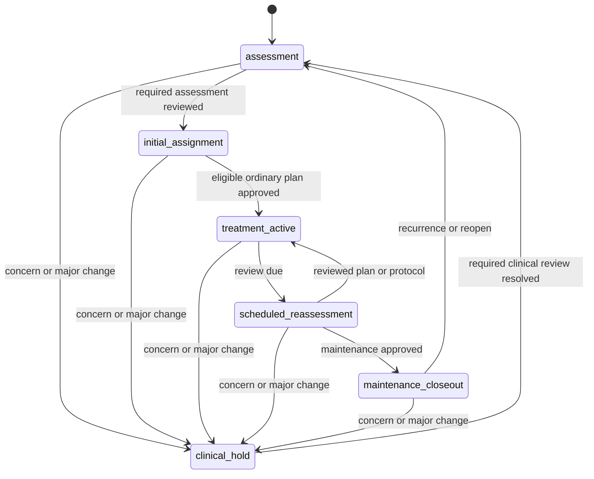

# G0-WORKFLOW version 1.0.0 candidate

Status: low-fidelity synthetic workflow proposal awaiting independent exact-head/base review. These sketches define information/action placement and state ownership; they are not detailed visual design, a runnable UI, human-tested screens, clinical agreement or manual accessibility acceptance. The synthetic demonstration has no real patients, orders, messages, device accounts or clinical systems. Human-factors, clinician/nurse/behavioral review, ethics determination and clinical validation remain **not started/deferred**. Agents cannot approve those gates.

Inputs: accepted G0-CONTRACT at main `6c3fb070d36bfefbd070f2a2c33ccba7631734be`, [scope/coordination](../spec/00-scope-and-invariants.md), [service/UI](../spec/06-service-and-ui.md), [patient workflow](../plans/ux/03-patient-decision-workflow.md), [requirement map](../spec/requirement-map.md), [G0 bundle](../spec/08-gates-and-release.md), engineering guidelines and G0 ledger/technical plan. Exact shared enums/versions are consumed from `contracts/domain/entities.py`, `boundaries.py`, `temporal-v1.json` and `estimand-registry-v1.json`; these sources remain unchanged. Thresholds below bind [DGP decisions v1](dgp-decisions.md) and are provisional synthetic engineering settings, not clinical estimates.

## State and authority

The service supplies patient/task/decision IDs, current/historical mode, clinical state, learning state, readiness, eligible actions and reasons, current holds/consents, cutoff and patient/state/eligibility/consent/model/evidence/policy versions. A selected tab never grants permission, changes treatment or infers readiness. Frontend renders these values and permitted commands. Backend authorization rechecks them on **every** write/draw. Authenticated single-doctor accounts own their synthetic panel; cross-owner IDs return denied without revealing data. Patient workspace here means the clinician's selected-patient workspace; no patient login role is silently introduced.

| Dimension | Accepted values | Authoritative owner / consequence |
|---|---|---|
| Clinical | assessment; initial_assignment; treatment_active; scheduled_reassessment; maintenance_closeout; clinical_hold | Clinical controller applies clinician-reviewed state and observed hold triggers. Clinical state constrains all learning. |
| Learning | none; nof1_design; nof1_block; nof1_washout; nof1_review; escalation_decision; support_active; support_frozen; support_unavailable | Approved protocol/support controller within clinical/consent envelope; cannot change treatment eligibility. |
| Data readiness | ready; incomplete; stale; failed | Service assessment of required data/review for this command. Incomplete/stale data is a task blocker, distinct from clinical hold. |
| Support mode | fixed; mrt; adaptive; frozen; paused | Approved versioned support policy plus N1 freeze rules. `support_frozen` may coexist with treatment_active. |
| View | current; historical; retrospective_evaluation | History controller. Historical and retrospective views are read-only regardless of current clinical eligibility. |

These are parallel dimensions: treatment_active + nof1_washout + data incomplete + historical view is possible, and no assignment follows from that combination. Medication order, randomized proposal/assignment and delivered/taken treatment are separately logged immutable events. Ordinary care, randomization and permission to claim model superiority are three separate decisions. The UI never has a preselected winner; sorting means is not a superiority claim.



Any state can enter a hold. Re-entry always revisits assessment; it never jumps directly to the old experimental assignment. No learning transition overrides the clinical diagram. Learning branches are no experiment → N1 design → randomized blocks/washout → N1 review; continuing behavioral treatment → response reassessment → eligible escalation review; and support unavailable/fixed → MRT → qualified adaptive support. Branches require their own current approvals and consent. Durable behavioral skills persist through all branches; there is no CBT-I on/off washout.

## ASSIGN-01 through ASSIGN-10

Every row uses the same persistent patient/time/version banner and task-local Assess / Compare options / Decide and follow up views. The following is the service/action map, not a claim these transitions have been implemented.

| ID / task | Clinical + learning state | Assess/readiness and owner | Compare evidence shown | Allowed actions; explicit denial |
|---|---|---|---|---|
| ASSIGN-01 Assessment incomplete | assessment + none (support_unavailable if blocked) | Doctor reviews sleep history, goals, ISI/diary, daytime impairment, opportunity, contributors, alternative disorder/referral needs, current medicines, stability/fall risk; nurse may collect designated missing data. Dates/checklist distinguish missing from pending. | Required inputs and discordance only; comparison remains unavailable. | Request data, record reviewed assessment, refer, defer, hold. Deny treatment comparison/ranking fabricated from absent data and deny randomization before assessment/consent. |
| ASSIGN-02 Initial assignment/cold start | initial_assignment + none | Doctor confirms goals, contributor review, clinical stability, medication reconciliation, feasible care and preference. Service returns eligible/excluded/requires_prescriber_review reasons. | Compatible source evidence, source-to-target limits, prior-only/local status, intervals and no-borrowing/heterogeneity sensitivities. Never individual-trial evidence that does not exist. | Doctor explicitly chooses eligible ordinary plan with rationale/preference and owned follow-up, approves or defers. Deny ineligible/unreviewed plan and model superiority if prior-only/unsupported; ordinary care may proceed with documented rationale. |
| ASSIGN-03 Treatment active/no decision due | treatment_active + none or support_active/frozen | Nurse monitors assigned tasks, adherence, actual delivery, burden/harms and report maturity; doctor reviews concerning changes. | Coverage and review triggers, current plan and next review; no fresh medication choice each night. | Continue monitoring; doctor records clinically justified amendment or hold. Deny forced reassignment and silent plan change from a new estimate. |
| ASSIGN-04 N1 eligibility/design | treatment_active or scheduled_reassessment + nof1_design | Doctor confirms both fictional medications acceptable, stable period, interactions/fall risk/rescue plan, reversibility/onset/offset, patient agreement, current nof1 consent and oversight. Behavioral clinician may advise burden/content. | Endpoint, blinding, randomization, active/washout schedule, carryover/rebound, expected precision/burden, stop rules and support freeze snapshot. | Doctor approves protocol, revises or declines. Deny crossover of durable behavioral skills, unconsented comparison, one acceptable option or unsupported protocol version. |
| ASSIGN-05 N1 block active/next block | treatment_active + nof1_block or nof1_washout; support frozen | Service validates current phase, washout, outcome maturity/reporting, consent, hold, assigned vs taken/rescue/adverse status. Nurse follows designated data tasks; doctor reviews pause/stop triggers. | Exact current block, incomplete/pending outcomes, carryover/washout and prespecified interim boundary; frozen policy ID visible. | Only protocol-prescribed next block when ready; pause or stop with reason. Deny manually selecting a numerically winning next block while retaining randomized-analysis claim, and deny drifting support. |
| ASSIGN-06 N1 interim/final review | scheduled_reassessment + nof1_review | Doctor reviews goals/function, burden, tolerability, deviations, informative blocks; patient preference recorded. | Assignment contrast and interval on quality scale, serial correlation/trend/carryover/rebound, block count and uncertainty. Distinguish lack of information from no effect. | Continue protocol, select eligible long-term ordinary plan, mark inconclusive or redesign with new approval/version. Deny declaring winner with insufficient blocks/maturity/precision. |
| ASSIGN-07 Behavioral reassessment/escalation | scheduled_reassessment + escalation_decision | Doctor/behavioral clinician review continuing program completion/skills, day28 response, function and adherence barriers. Doctor confirms nonresponse classification, SMART eligibility and escalation consent. | Prespecified ISI response/timing; stage contrast distinct from embedded-strategy value; prior assignments/path probabilities and uncertainty. | Continue, ordinary clinician-guided escalation, or separately approve eligible sequential randomization. Deny erasing acquired skills and conflating randomized second-stage evidence with identified first-stage regimes. |
| ASSIGN-08 MRT/bandit support review | treatment_active or scheduled_reassessment + support_active/frozen/unavailable | Doctor approves content/envelope; behavioral clinician reviews content/burden; nurse follows support tasks. Service computes consent, preference, availability and caps before draw. | Prompt-effect uncertainty, final assignment-probability bounds, proximal next-morning reward vs distal ISI, missingness/drift/support, policy/freeze version. | Approve/change envelope, pause, fixed support; controller chooses only approved support inside envelope. Deny medication actions, assignment when unavailable, unqualified adaptation or changing an N1 freeze. |
| ASSIGN-09 Hold/major phase change | clinical_hold + retained/suspended learning status; support paused | Doctor owns clinical clearance; nurse can record/flag concern and owned follow-up; clinical controller immediately blocks assignments. Show reason, changed state, responsible person, required review and dates. | Old predictions marked potentially inapplicable; historical evidence retained with old cutoff. No current ranking from stale eligibility. | Record review, request clinical review, resolve prerequisites and re-enter assessment. Deny experimental assignment and reuse of old approval/readiness, even before refit. |
| ASSIGN-10 Maintenance/closeout | maintenance_closeout + none or fixed/paused support | Doctor reviews sustained reports/function, preferences, current treatment and recurrence/therapy review; nurse owns follow-up tasks. | Evidence maturity, remaining recurrence uncertainty and next review. | Maintain, close episode, reopen assessment; stop experimental scheduling when closed. Deny closure implying cure or automatic re-enrollment on recurrence. |

## Role × action permissions and denials

All allows below additionally require account ownership, current mode, service readiness/eligibility, current version and action-specific scope. Researcher is the existing research/statistics configuration role, not a clinical approver. Controller is an internal executor of a persisted clinician-approved envelope; it is not a new human authentication role or permission to forge doctor identity. Where the current domain function requires doctor actor context, the service passes the original validated approval plus its internal execution identity/audit; a future route must not let a controller submit a human approval.

| Action | Doctor | Nurse | Behavioral clinician | Research/statistics | Support controller |
|---|---|---|---|---|---|
| Read owned panel/current history/basis | Allow owned resources | Only designated authorized follow-up context | Only designated component review context | Only permitted deidentified/synthetic configuration/evaluation context | Only minimum available observed support context |
| Collect/review task data | Allow clinical review | Allow designated collection/follow-up; cannot attest doctor review | Allow designated behavioral review | Deny clinical attestation | Deny human review |
| Save task draft | Allow own clinical task | Only own designated follow-up draft | Only own component-review draft | Only configuration draft | Deny human draft |
| Approve ordinary treatment/amendment | Allow eligible option with rationale/follow-up | Deny: no prescriber approval | Deny: advise component, no plan approval | Deny: no clinical authority | Deny: support only |
| Approve N1/SMART/support envelope | Allow current eligible protocol/component | Deny: follow-up role | Deny: recommendation/content review only | Deny: may define permitted comparisons | Deny: execute existing approval only |
| Configure permitted comparisons/threshold version | Review clinical applicability; cannot tune confirmation | Deny | Review content, cannot tune confirmation | Allow versioned research configuration before development/confirmation lock | Deny |
| Record component agreement/consent status | Allow synthetic record with origin/version/date; actual oversight deferred | Record documented withdrawal/expiry/concern through designated workflow; no fabricated approval | Record documented component agreement/review, no fabricated oversight | Record synthetic oversight configuration only, no patient consent claim | Read latest envelope; cannot manufacture consent |
| Flag clinical concern/hold | Allow | Allow flag through clinical controller; blocks immediately pending review | Allow flag through clinical controller | May report data/system issue; no clinical clearance | Enforce existing hold; cannot diagnose/clear |
| Clear clinical hold/re-enter | Doctor only after documented required review and current assessment | Deny: review owner required | Deny: advise, not clear | Deny | Deny |
| Draw next approved N1/SMART assignment | Approved protocol executor after recheck, not manual choice | Deny manual choice | Deny manual choice | Deny patient assignment | Deny: support controller cannot assign medication/escalation |
| Choose support offer | Approve envelope/pause/fixed support; no retrospective propensity edits | Deny unscheduled policy change | Recommend content/envelope only | Configure allowed method, no patient draw | Allow approved available support/no-prompt with final logged p before outcome |
| Write historical/retrospective view | Deny read-only | Deny read-only | Deny read-only | Deny read-only | Deny read-only |
| Read evaluator truth in learner/UI route | Deny | Deny | Deny | Deny through clinical/learner routes; evaluator process is separate | Deny |
| Cross-owner patient ID/credential reset bypass | Deny | Deny | Deny | Deny | Deny |

The first synthetic app remains a single-doctor account model. Nurse/behavioral/research rows specify domain ownership and future scoped permissions; they do not require exposing multi-role clinical accounts before their routes/auth are implemented and reviewed. Roles cannot gain access just because the sketch shows an owner label. Any unsupported role/action combination is denied, not silently elevated.

## Consent, hold, freeze and re-entry

There is one current lineage for each component: `nof1`, `escalation`, `mrt_bandit`. Each record carries consent/oversight versions, effective/expiry/withdrawal times, event/recorded/available timestamps, source, revision, supersession/retraction. Permitted synthetic state is consent active + oversight approved_synthetic, effective/available before draw and not expired/withdrawn/retracted. Missing/pending/expired/withdrawn records block that component **before** any random number is drawn. Retraction selects the current tombstone and cannot revive an earlier approval. Withdrawal stops future assignment, preserves prior assignments/delivery/consent history, and creates an owned review task for ordinary care or fixed support where still permitted. A synthetic approved_synthetic record never claims IRB/ethics approval or actual informed consent.

Every hold records trigger, reason, time/availability, owner, blocked actions, changed facts, required review and clearance evidence. Possible synthetic triggers include admission, regimen/steroid change, deterioration, adverse symptoms, suspected infection/fever, confusion/fall and clinician concern. Clinical eligibility precedes optimization. Holds immediately invalidate approval/draw readiness independently of refitting; label previous predictions potentially inapplicable. Existing delivery/exposure is recorded faithfully, not erased to fit the held state. The demo routes a simulated follow-up task; it sends no real message/order. Data gaps instead set incomplete/stale/failed readiness and a data task; they do not assert a clinical diagnosis or clear a hold.

During N1 active blocks **and washout**, freeze the entire patient support snapshot: content, coefficients/posterior parameter version, context transforms, policy mapping, probability/bounds, burden handling, missing-history rules, eligibility constraints and reference support. Other patients may update global models, but the frozen patient mapping remains immutable. Any known withdrawal/hold can further restrict or pause the snapshot, never expand it. A stopped N1 protocol does not resume adaptive support automatically: N1 review → current consent/eligibility/envelope review → explicitly approved new support-policy version. Keep old policy IDs in every relevant estimand, block/assignment/decision snapshot. Phase change or washout failure returns through clinical review/assessment; do not recycle old block approval.

## Thresholds, evidence and outcomes

Provisional synthetic threshold table v1.0.0 (provenance `provisional_synthetic_engineering`, clinical_review deferred): response day28 ISI improvement>=6 from day0; final strategy ISI day84; meaningful benefit3 ISI points or .5 daily quality points; N1 seven active days/block, two washout days, at least two informative blocks including A/B and >=70% per-block reports; early-stop review after two complete blocks if mean available quality<3 or an adverse concern; experimental stability review if any dimensionless L>3. Those cutoffs are demo behavior, not clinical adequate washout/stability/response recommendations. Missing required observations make response or block information inconclusive, not automatic nonresponse.

Model superiority also requires eligibility, current consent where relevant, mature endpoint, accepted computation, declared overlap>=.05, no target weight>20, effective sample>=20, ISI interval width<=6, tail-probability MCSE<=.0025, and sensitivity stability. These are synthetic defaults requiring development qualification. DECISION-01 evaluates .95/.975/.99/.995 probability cutoffs on development only and selects least stringent satisfying one-sided95% exact upper clinic-wide false meaningful-superiority bound<=.05 across locked null cells. **No cutoff is selected or claim enabled in G0.** Until development acceptance, state is abstained/no superiority claim. No passing synthetic threshold is clinician agreement or permission to change medication automatically. Unsupported estimates allow an eligible ordinary-care choice with explicit rationale while denying unsupported comparative claims/randomization.

Every estimate includes exact saved outcome/comparator, units and direction, population/event strategy, horizon, interval type, cutoff and estimand/model/policy/evidence versions; basis detail resolves the immutable input snapshot. Patient report, wearable estimate, causal effect and clinician judgment remain labeled separately. Average-effect credible/confidence intervals are distinct from individual prediction intervals. A number is shown only when actually produced and saved by the backend; low-fidelity sketches deliberately contain status placeholders.

| Backend/UI condition | Visible meaning/action |
|---|---|
| Loading | Work requested; indicate what is being loaded, retain context; no old result relabeled current. |
| No data / missing | No observation available; gap and source/date shown, owned data task. Do not render improvement or zero. |
| Pending / outcome not mature | Expected data/reward window not complete or not available yet; show due date/availability. |
| Prior only | No local likelihood update; display prior dependence and transport limits, no fabricated individual evidence. |
| Estimated / current | Render saved backend numeric value and labeled interval/units without client recomputation. |
| Valid but inconclusive | Defined contrast with insufficient precision/support or exhausted truth computation; no winner. |
| Undefined | Target mathematically undefined, e.g. zero alive-outpatient denominator; show reason, never zero ISI. |
| Failed | Fit/data/system computation failed; retained attempt/reason/retry owner, no successful substitute. |
| Abstained / unsupported | Claim or method withheld by support/precision/decision gate; explain prerequisite. |
| Stale / invalidated | New hold/consent/state/model applicability changed; compare only after current review/refit as required. |
| Unavailable action | No legal/eligible action, preserve unavailable event and explanation rather than synthesize a draw. |

For interruptions, show survival through42, hospitalization by42, alive-and-outpatient on42, and **each intervention's own** conditional ISI with denominator/probability/event times. Zero conditioning probability is undefined. Never show post-death ISI, a common-survivor causal claim, a composite utility or an overall winner across tradeoffs.

## Low-fidelity panel sketch

Persistent simulated-demo label, stable NHS-informed shell, readable text statuses, patient identity and actions are the design constraints. This sketch is an information layout, not a typography/color approval.

```text
Synthetic demonstration - simulated patients and estimates
[Skip to main] REMission                         Signed in: Doctor [Account]
My panel | Guide | Technical appendix

My panel                         Appointment date [All] Stage [All]
3 of 12 scheduled patients need data review. Updated [service timestamp]
Patient / appointment | Next task / owner | Clinical / learning | Hold / readiness
[Fictional patient A] | Initial plan/doctor | Initial/none | No hold / incomplete
                      Missing diary [date]. [Open assessment]
[Fictional patient B] | Block review/doctor | Active/N1 washout | Review required
                      Frozen support [version]. [Open current task]
Rows expand for report dates, assignment/delivery, follow-up and source detail.
```

The worklist is doctor-owned. Counts link to the same filtered list with denominator/time. Default sort uses configured review/due tasks, not model-inferred urgency or presumed treatment benefit. Identity, next task/owner, hold and readiness remain inline. Narrow screens stack each row as a labeled list; supplementary fields expand, while identity/hold/readiness cannot disappear. No horizontal dashboard of unrelated decorative scores.

## Low-fidelity selected-patient and task sketches

```text
Synthetic demonstration - simulated patients and estimates
[Patient ID/name] [phase/regimen] [Current] Decision [date] Data cutoff [timestamp]
Clinical: [state]  Learning: [state]  Readiness: [service status]
Overview | Current decision | Monitoring | History

Overview
Current approved plan [version]    Next task [owner, due]
All open tasks [choose task explicitly]
Recent report [measurement date/recall]    Wearable estimate [coverage/version]

Current decision - [service task title: Initial plan / Block 2 review / Hold review]
Assess | Compare options | Decide and follow up
Task context [ID] / approved background care / outcome+horizon / policy version

Assess
Goals [review]  Contributors [dated checklist]  Current medicines [review]
Consent [component/version/status/date]  Eligibility [option: reason]
Hold [reason, owner, required review] OR Data gap [source, date, next action]
[Save assessment draft] [Request data] [Enter/flag hold]

Compare options
Outcome [saved label], comparator [saved label], horizon [saved days]
Option A: [not selected]  Estimate [backend status/value only]
Interval [type/level/units/direction]  Cutoff [time]  Evidence [status]
Applicability [overlap/transport/fit/missingness limits]
Harms and burden [separate]  Preference/feasibility [recorded]
[Inspect basis] [What does this estimate mean?]
Option B: [not selected]  same labels/scales/reference
When blocked: Insufficient evidence to rank these options. [Reason/prerequisite]

Decide and follow up
Purpose [Choose ordinary plan] OR [Approve named randomization protocol]
Explicit choice/protocol [none preselected]  Patient preference [field]
Rationale [field]  Follow-up [owner / due / trigger]
Summary of action, support-policy version and changed facts [review]
[Save draft] [Defer] [Hold] [Approve ordinary plan / Approve protocol]
```

Task title/content comes from the ASSIGN table; tabs remain stable. Initial cold start uses source/prior limits, N1 block views use assigned-vs-taken/washout/frozen support and prescribed-next-block controls, escalation uses response/strategy history, support review uses availability/propensity/missingness, hold view suppresses assignments and names clearance prerequisites, maintenance shows recurrence uncertainty. A support task does not display a default N1 plot. Intervention-specific interruption panels replace scalar comparisons with separate outcomes and denominator labels. Controls display service-denial reasons accessibly; a useful explanation remains reachable even when an action is disabled.

Monitoring aligns ISI assessment points and 14-day recall windows, daily quality/function, and wearable estimated sleep on a common time axis with separate scales and accessible tables. Show gaps, coverage, device-version shift, treatment/order/actual-exposure, chemotherapy/steroid, N1/washout and hold lanes, with source links. Explain that quiet-wake misclassification can overestimate sleep; do not automatically reconcile report/wearable disagreement. Current decision carries only the relevant monitoring excerpt.

```text
History - read-only as known then
[Patient banner] [Historical snapshot date/ID] [cutoff] [versions]
[Immutable assessment/permissions/estimates/approval as known at this cutoff]
[View later outcomes - retrospective, separate label]
[Return to current]   No write/approve controls
```

Historical URLs retain snapshot mode on reload; later outcomes must be explicitly requested, labeled retrospective and must not rewrite the old prediction/permission. Return to current is explicit and revalidates state. Choosing a historical decision never changes active treatment or silently carries a historical draft into a current task.

## Draft, approval and current-version atomicity

Draft key = authenticated owner + patient + task + decision + base state version; drafts are separate from approvals/assessment events. Preserve a draft across task-local subviews. Patient/task/account switch clears local inputs and offers Save draft / Discard / Cancel before leaving; explicit saved-server-draft resume requires current-state revalidation. Refresh warns about unsaved local input; session expiry clears local inputs and explains only saved drafts recover. Same-doctor reauthentication does not silently restore stale local drafts. Drafts/credentials never enter URL/history/shared caches.

Approval displays concrete purpose/choice or allowed randomization options, rationale, preference and owned follow-up. Submit binds patient/task/decision, expected patient/state/eligibility/consent versions, model/evidence/policy applicability, owner/auth generation, current view and idempotency key. In one transaction recheck current identity/ownership, versions, holds, component consent/oversight lineage, data readiness and allowed actions; persist approval, new plan/protocol status, follow-up, audit and next version atomically. Roll back all on any failure. A stale hold/withdrawal arriving during review wins before draw even if estimates are unchanged. Saving a draft cannot side-step that transaction.

Double-click/retry uses the original idempotency key and identical intent. Lost response shows Checking approval status and retrieves the durable result using that key; never create a new key while outcome is unknown. Clear draft only after confirmed persistence. Material changed facts require fresh review; an approval is not a fit request and must not launch a costly refit silently. Subsequent randomized/support draw rechecks current hold/consent/eligibility under serialized/versioned authority immediately before persisting final propensity and assignment; no random number is consumed for a denied action. Original assigned option, clinician override, delivery/adherence/rescue and any amended plan remain separate events. Exact storage isolation/auth/idempotency implementation belongs to G0-LIB/G1/G5, not this sketch.

## Low-fidelity contextual help and accessibility handoff

```text
[What does this estimate mean?] opens labeled help panel (keyboard reachable)
Title: [task-specific concept]
Plain explanation: [e.g. average assignment effect, not an individual guarantee]
For this decision: [outcome/comparator/horizon/units/cutoff/status]
What is known / uncertain: [prior, support, fit or missingness limits]
Next action: [inspect basis / review data / return to task]
[Source and method details] [Close help; return focus to trigger]
```

Help follows patient/task/view context, uses service statuses and versioned terms, and contains no invented numerical result or evaluator truth. Initial-plan help explains prior-only evidence/transport; N1 explains assignment vs taken/carryover/rebound; escalation explains stage vs strategy; support explains proximal vs distal and probability; interruption help explains intervention-specific conditional populations; history help explains as-known-then. Guide and Technical appendix provide deeper methods, source limitations, versions, fit failures and synthetic claim boundary without replacing inline blockers.

Applied installed skills: `C:/Users/erics/.codex/skills/react-best-practices/SKILL.md` with `rules/async-parallel.md`, `rules/rerender-derived-state-no-effect.md`; `composition-patterns/SKILL.md` with `rules/architecture-avoid-boolean-props.md`; and `web-design-guidelines/SKILL.md` with fresh upstream command.md retrieved 2026-10-21 UTC. The retrieval hash/provenance is recorded in G0-WORKFLOW evidence. UI architecture follows explicit current/history/task variants and service-derived readiness; parallel reads only after authorization, no shared mutable patient cache and no Next.js/React19/runtime/hosting change is implied. This is a contract review, not a rendered-UI compliance pass.

Semantic links navigate and buttons act; every field has a visible label, errors name the fix and focus first invalid control, asynchronous status uses an appropriate live region, focus is visible/unobscured, help/dialog focus returns to its trigger, no critical explanation requires hover, no chart relies on color alone. Narrow/zoomed layout keeps identity/hold/cutoff readable and has tables for charts. Use dates/numbers through locale-aware formatting, reduced-motion support, no auto-focus or decorative animation, and a skip link. Generic skill advice to keep submit enabled does not override service permission/hold denials; disabled actions retain readable reasons and useful alternatives. Only nonsecret navigational state goes in URLs. Actual keyboard/screen-reader/reflow/contrast/manual accessibility work, rendered desktop/narrow screenshots, browser persistence tests and real intended-user sessions remain outstanding G5/HUMAN-REVIEW.

## Evidence boundary and integration obligations

G0-WORKFLOW provides ten-stage coverage, parallel states, role/action denial rules, consent/retraction, holds/re-entry, frozen support, ordinary-care/randomization separation, immutable history, drafts and approval atomicity, explicit statuses and low-fidelity panel/patient/help sketches. Independent Astra reviews this artifact against canonical requirements. No front-end/service execution, browser test, clinician observation or manual accessibility result is supplied. Later G1/G5 must implement actual transactions/auth/current constraints and exercise stale hold/consent races, historical reload/read-only writes, same-doctor reauthentication, patient/task draft isolation, explicit save/resume, double click/lost response, amendments and exact saved-result rendering. Browser automation cannot accept human/clinical gates.
