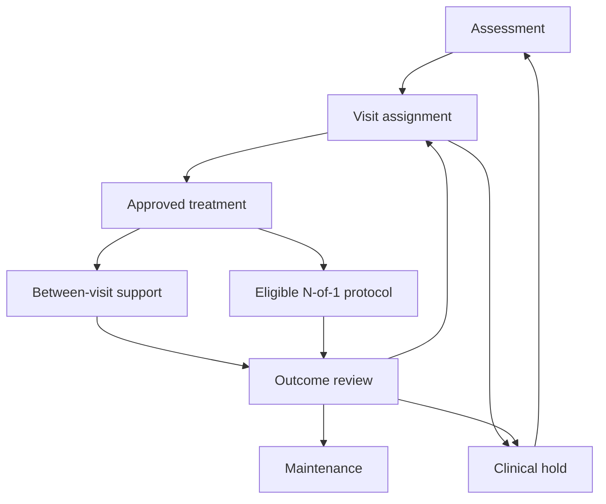

# Scope and shared invariants

**Immediate PoC precedence (2026-10-22):** the [PoC amendment](poc-amendment-20261021.md) controls active scope, sequencing and acceptance over conflicting full-program requirements below. The immediate Google Cloud physician simulation milestone requires POC-CLOUD-01 through POC-CLOUD-05, POC-1 through POC-3 and the workflow/persistence/failure portions of POC-6. Training/fitting, POC-4/5, fitted protocol representatives, APPT-01–05 and POC-VAL remain later analytics acceptance; retain relevant invariants and independent review. Exhaustive G0-G7 counts, deferred engines and human/clinical gates are later work, not prerequisites for synthetic PoC operation. Existing historical evidence retains its original scope.

Specification revision: 2026-10-19. Status: requirements only; no implementation or validation result is asserted.

**Read first:** [plan index](../../plan.md). Read linked scenario and evidence entries only when needed.

**Inputs:** versioned upstream contracts and applicable scenario IDs. **Outputs:** the contracts, artifacts and checks specified below. **Acceptance:** relevant G0–G7 evidence in [gates](08-gates-and-release.md); statistical checks use the [validation protocol](07-validation-protocol.md).

## SYN-BOUNDARY — Synthetic validation claim boundary

The initial deliverable is a research-grade synthetic demonstration. Validate software/simulator correctness, Bayesian computation, causal recovery under declared assumptions, robustness to misspecification, and closed-loop policy behavior separately. Passing one is not evidence of passing the others. Clinical validity and real human-factors acceptance require separate evidence.

Use three generator layers: analytic fixtures, a longitudinal reference environment, and independently specified adversarial generators. All numerical effects, thresholds, kinetics and sample sizes are engineering choices unless an explicitly reviewed quantitative extraction states otherwise.

Keep survival, hospitalization and conditional symptom outcomes separate when interruptions occur. Suppress automatic overall ranking when these outcomes trade off. Ordinary clinician care remains possible inside eligibility rules.

The full hybrid remains required; adaptation and superiority claims are gated capabilities, not guaranteed development outcomes. Fixed support and inconclusive comparisons are valid outputs. No test may require detecting hidden confounding that is indistinguishable from observed data.

## 1. Recommendation and intended demonstration

Build the recommended hybrid workflow:

1. **At outpatient decision points:** a hierarchical Bayesian longitudinal causal model estimates the outcomes of clinically eligible treatment plans. A robust prior borrows cautiously from compatible previous studies.
2. **For suitable reversible comparisons:** a clinician-approved randomized N-of-1 protocol generates patient-specific evidence, with explicit carryover, withdrawal/rebound, adherence, and stopping rules.
3. **For durable behavioral treatment:** maintain CBT-I or brief behavioral treatment as a continuing intervention; use a separate sequential randomized escalation pathway rather than withdrawing acquired skills for crossover.
4. **Between appointments:** first use micro-randomized trials (MRTs) of the delivery of already approved behavioral support. Then demonstrate a bounded hierarchical contextual bandit that optimizes those support decisions.
5. **Throughout:** clinicians control treatment assignment. Clinical eligibility rules restrict the action set before the model ranks options. Every randomized component (N-of-1, sequential escalation, MRT, bandit) additionally requires a recorded consent and oversight status before any assignment is drawn (section 2.1).

This composition connects population evidence, prospective individual learning, and modest online adaptation while preserving the different timescales and assumptions of each method. Bayesian g-computation, Bayesian N-of-1 analysis, MRTs, and hierarchical contextual bandits provide established methodological starting points.[gformula](../evidence/causal.md#gformula)[n1bayes](../evidence/experiments.md#n1bayes)[mrt](../evidence/experiments.md#mrt)[pooling](../evidence/experiments.md#pooling) Their combination in this leukemia insomnia app is a proposed design, not an already validated clinical intervention.

The demonstration must show the full loop: ingestion → assessment → eligible choices → posterior estimates → clinician approval or randomization → simulated delivery → outcomes → model update → next decision → historical review. "Full machinery" includes failures, abstention, and audit trails, as well as successful personalization.

**Cold-start qualification:** previous studies can inform average effects and uncertainty. They cannot establish a new patient's treatment response, identify an unmeasured confounder, create overlap, or supply Oura-based effect modifiers absent from the studies.

### Alternative compositions

| Composition | How it works | Advantages | Limitations | Decision |
|---|---|---|---|---|
| Bayesian population model at visits | Borrow study evidence, update with historical EMR and prospective outcomes, rank eligible plans | Simplest workflow; explicit uncertainty; works before individual experiments accumulate | Individual conclusions may remain prior-driven; observational identification and transport assumptions remain substantial | Useful first development milestone |
| N-of-1 centered workflow | Each suitable patient completes repeated randomized comparisons with hierarchical pooling | Direct evidence about that patient's reversible treatment choices; assignment probabilities are known | Carryover, withdrawal/rebound, unstable chemotherapy phases, burden, and limited suitable options; durable CBT-I learning does not wash out | Optional branch, not the default for every patient |
| **Recommended hybrid** | Bayesian visit decisions + selected N-of-1 protocols + sequential behavioral escalation + constrained support bandit | Uses each method where its assumptions fit; supports ordinary outpatient follow-up; separates treatment choice from support delivery | More engineering; requires estimand discipline and explicit coordination rules across learning components (section 3.1) | **Build this demonstration** |
| Long-horizon treatment RL | Optimize treatment sequences and delayed outcomes across visits | Could address multi-step treatment tradeoffs | Demands a credible state representation, adequate exploration/support, delayed-outcome evaluation, and reliable safety constraints; simulation performance would not establish clinical validity | Future research extension; not the clinical assignment engine in this prototype |

The contextual bandit is the initial online reinforcement-learning component. It optimizes proximal support delivery; it does not claim to optimize the entire chemotherapy insomnia trajectory. Longer-horizon policy evaluation may be demonstrated offline, with its assumptions stated separately.[actionbandit](../evidence/experiments.md#actionbandit)[ope](../evidence/experiments.md#ope)

## CLIN-UPDATE — Evidence scope and certainty

Retain the behavioral-care pathway while distinguishing survivor CBT-I evidence from brief behavioral treatment during active cancer treatment. The 2025 Cochrane review characterizes evidence as very low to moderate certainty and benefits more cautiously than some older syntheses. Record comparator/outcome/population differences before any future real quantitative extraction. [esmo](../evidence/clinical.md#esmo) [cochrane-cbti](../evidence/clinical.md#cochrane-cbti)

Include leukemia-chemotherapy mindfulness evidence in the clinical search, without treating it as CBT-I, an ISI effect, or prompt-timing evidence. Record the short inpatient mucositis hypnotic trial as a near-match with setting/horizon exclusions. These studies do not inform fictional medication efficacy coefficients. [zhang-leukemia](../evidence/clinical.md#zhang-leukemia) [dimsdale-inpatient](../evidence/clinical.md#dimsdale-inpatient)

## 2. Clinical pathway and boundaries

Start with clinical assessment, not a sleep score. The cancer insomnia guideline and cancer symptom workflow support assessing insomnia symptoms, daytime consequences, contributing conditions, and treatment options.[esmo](../evidence/clinical.md#esmo)[ontario](../evidence/clinical.md#ontario)[nci](../evidence/clinical.md#nci)

| Step | Information and action | Representation in the prototype |
|---|---|---|
| Confirm the problem | Sleep history, patient goals, insomnia severity, daytime impairment, sleep opportunity, and a diary; clinician considers alternative or coexisting sleep disorders | Structured assessment plus notes; ISI (with its version and recall interval) and diary are visible beside wearable estimates |
| Identify contributors | Chemotherapy phase, corticosteroid exposure, pain, nausea, distress, fatigue, naps, other medications including already-prescribed sedating agents, and possible breathing or movement disorders | A dated contributor list with evidence source, review status, and responsible clinician |
| Address contributors | Coordinate symptom management and any changes to oncology or supportive medicines with the relevant clinician | Tasks and referrals; the optimizer cannot independently change chemotherapy or corticosteroids |
| Select behavioral care | Offer evidence-based behavioral insomnia care suited to treatment burden and clinical stability | Continuing brief behavioral or CBT-I program, with adherence and skills tracked |
| Consider medication | Review existing therapy, interactions, contraindications, sedation and fall risk, and clinical need; specify a reassessment and stop/review date | Clinician-controlled medication choice; synthetic agents in demonstrations |
| Reassess | Review symptoms, function, harms, adherence, goals, and whether the treatment is still appropriate | Outcome review at usual appointments; interim review when a configured clinical trigger occurs |

ESMO recommends CBT-I as first-line therapy for insomnia in adults with cancer and distinguishes the role of brief behavioral interventions during active treatment; medication requires cautious use and review.[esmo](../evidence/clinical.md#esmo) Severe sleepiness and medical instability are reasons to adapt or defer relevant behavioral components, including sleep restriction, rather than apply a uniform digital protocol. The VA/DoD provider material, for example, lists an uncontrolled seizure disorder as a reason to delay and bipolar disorder as a reason to adapt.[va](../evidence/clinical.md#va) These are clinician-entered eligibility flags in the prototype, not automated determinations.

Use leukemia-specific clinical context to determine eligibility and transportability. The cited brief behavioral therapy trial during chemotherapy randomized 71 patients with breast cancer and was designed as a feasibility and acceptability study; it is relevant external evidence but is not equivalent to a leukemia chemotherapy trial, and its effect estimate is preliminary.[palesh](../evidence/clinical.md#palesh) The app must visibly identify such population differences.

**ISI interpretation.** The ISI is a seven-item, 0–28 self-report scale that has been validated in a large mixed-cancer sample, where a score of 8 performed as the screening cut-off.[savard](../evidence/clinical.md#savard) It has not, to our knowledge, been validated specifically in leukemia chemotherapy. Change thresholds in the literature have different origins: a 6-point minimally important difference derived from a hypnotic drug trial, and a change of about 8 points associated with moderate improvement in a behavioral-treatment sample.[isi_mid](../evidence/clinical.md#isi-mid) The prototype therefore (a) treats any benefit threshold as a named, configurable, clinician-agreed parameter rather than a built-in constant, and (b) records the ISI version and recall interval with every administration, because two-week and one-month forms are both in circulation and must not be trended against each other.

**Wearable limits.** Oura measurements are supportive observations. The cited validation study enrolled 96 healthy Japanese adults aged 20–70 and was partly funded by the manufacturer; it does not establish accuracy in leukemia chemotherapy.[oura_validation](../evidence/clinical.md#oura-validation) Consumer wearables generally detect sleep with high sensitivity but detect wake poorly (specificity of roughly 29–52% across six devices in one polysomnography comparison), so they tend to overestimate sleep where wake time is high, which is exactly the insomnia case.[wearable_spec](../evidence/clinical.md#wearable-spec) Oura states that the ring is not a medical diagnostic device.[oura_conditions](../evidence/clinical.md#oura-conditions) Do not diagnose insomnia, infer remission, or prescribe from a proprietary readiness or sleep score. The prototype also does not monitor wearable temperature or heart-rate signals for infection or other acute illness, and must say so in the interface.

**Medication demonstration rules.** For the runnable demonstration, use fictional medication identifiers MED_A and MED_B with simulated kinetics and harms. Do not encode real doses or simulated "clinical efficacy" as if it were evidence. A separately sourced illustrative interaction rule shows how medication exclusions work, and should demonstrate two distinct rule outcomes because the label does: the suvorexant label states that use with strong CYP3A inhibitors (posaconazole is named) is not recommended, and that a reduced dose applies with moderate CYP3A inhibitors (fluconazole, aprepitant, and imatinib are named).[suvorexant](../evidence/clinical.md#suvorexant) The first is an exclusion; the second is a "requires prescriber review" flag. Both co-medication classes are plausible in leukemia care, which is why the example is useful, but it must not become a comprehensive medication recommendation engine.

**Fall risk.** Sedative-hypnotic use was an independent risk factor for falls among hospitalized patients with hematological disease in one cohort.[falls](../evidence/clinical.md#falls) That evidence is inpatient and observational, so its transport to this outpatient population is uncertain; the prototype represents it only as a clinician-reviewed fall-risk item on the readiness panel that must be acknowledged before a sedating option is approved or entered into an N-of-1 protocol.

**Acute concerns.** Acute clinical concerns enter a clinical review/hold pathway. The prototype routes them to a designated care task and pauses experimental assignment; it does not provide automated emergency diagnosis or replace existing oncology escalation procedures. Hold triggers are configured by the clinical team in Phase 0; the simulator should include at least fever or suspected infection, new confusion, a fall, hospital admission, and a regimen change.

### 2.1 Research oversight and consent

N-of-1 trials sit on a contested boundary between clinical care and research. A survey reported by Stunnenberg and colleagues found that 43% of responding IRBs regarded them as research requiring approval, while others treated them as care or decided case by case.[n1ethics](../evidence/clinical.md#n1ethics) Sequential randomization across patients, MRTs, and an adaptive bandit are designed to produce generalizable knowledge and should be assumed to need ethics review in any real deployment.

For the synthetic demonstration, model this explicitly rather than ignoring it:

- Each patient carries a per-component consent and oversight record (N-of-1, behavioral escalation randomization, MRT/bandit), with status, date, version, and withdrawal.
- The policy controller treats a missing, expired, or withdrawn record as an eligibility exclusion. No randomization is drawn without it.
- Withdrawal stops future assignment and is logged; it does not delete prior assignment records.

The actual oversight determination belongs to the clinical translation project (section 18).

## 3. Workflow state and decision ownership

Model clinical state, experiment state, data readiness, and the selected historical view separately. A patient can be on an approved behavioral program while also having a pending medication review; one flat "step number" would misrepresent this.

**Clinical state**

- Assessment: information gathering and contributor review.
- Initial assignment: a visit-level plan is being selected.
- Treatment active: the approved plan is being delivered.
- Scheduled reassessment: a visit reviews response and the next plan.
- Maintenance/closeout: continue, taper/review where appropriate, or close the insomnia episode.
- Clinical hold: reassess safety or a major change before resuming experimental choices.

**Parallel learning state**

- No individual experiment.
- N-of-1 eligibility/design.
- N-of-1 block active.
- N-of-1 interim/final review.
- Behavioral escalation decision.
- MRT/bandit support active, frozen, or unavailable.

The learning state never overrides the clinical state. A medication order, a randomized assignment, and a delivered intervention are different events.

Any state can enter a hold through the clinical controller. The diagram illustrates the principal loop rather than every possible transition.

**Ownership:** clinicians select and approve treatment plans; nurses manage designated follow-up tasks; behavioral clinicians review program components; the research/statistics configuration defines permitted experimental comparisons. The bandit selects only a support action inside the envelope previously approved for that patient.

### 3.1 Coordination between concurrent learning components

The N-of-1 endpoint (daily reported sleep quality) and the support-prompt reward (next-morning report) are the same kind of observation on the same nights. If the bandit adapts its prompt probabilities to outcomes while an N-of-1 block is running, prompt intensity can become correlated with the block treatment through the outcomes it is reacting to, and the N-of-1 contrast is then defined relative to a support policy that is drifting. This is a design consequence of running two learners on one outcome stream, not a finding from a specific study, so it is handled by rule and then tested in simulation (section 6):

- While an N-of-1 block or its washout is active, the support policy for that patient is **frozen** to a fixed, prespecified randomization (or fixed support). Adaptive updating for that patient resumes after the N-of-1 review.
- Each estimand contract names the support policy in force (section 4), so the N-of-1 and visit-level effects are interpretable as "under support policy version X."
- Pooled bandit updates may continue to use other patients' data.
- A newly randomized escalation assignment likewise records the support policy version in force.
